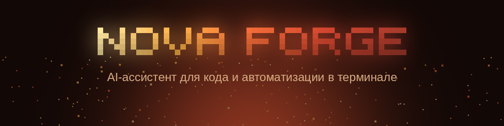
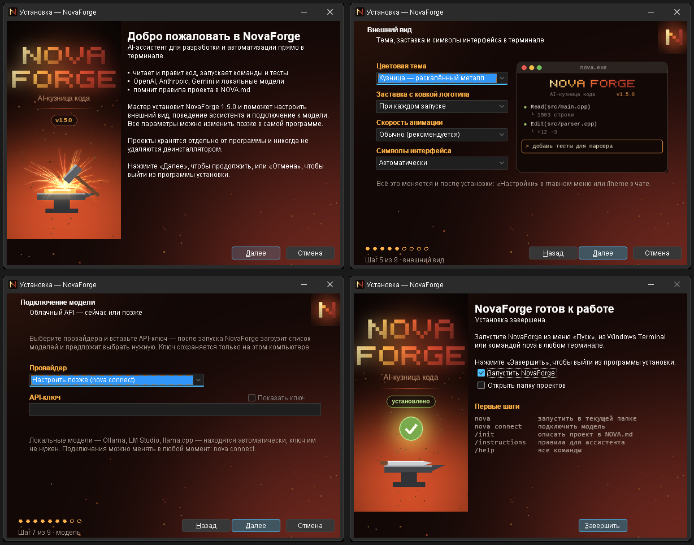
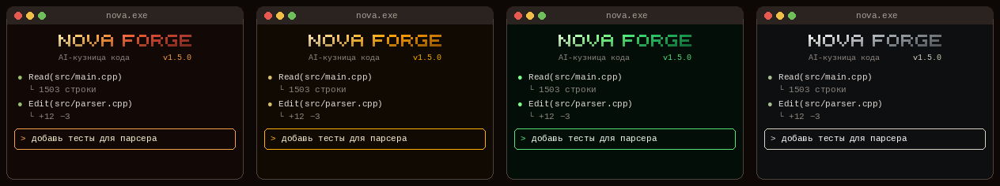

<div align="center">



**AI-ассистент для разработки и автоматизации прямо в терминале.**<br>
Читает и правит код, запускает команды, помнит правила проекта. Работает с облачными API и локальными моделями.

[](https://github.com/mofiks672-svg/novaforge/releases/latest)
[](https://github.com/mofiks672-svg/novaforge/actions)


[](LICENSE)

[Установка](#установка) · [Быстрый старт](#быстрый-старт) · [Возможности](#возможности) · [Автоматизация](#автоматизация) · [REST API](#rest-api) · [Конфигурация](#конфигурация) · [Сборка](#сборка-из-исходников)

</div>

---

## Что это

NovaForge — консольный AI-агент в духе Claude Code и opencode, написанный на C++17 с нуля: **один бинарник без внешних библиотек и рантаймов**. Вы описываете задачу словами — ассистент изучает проект, читает файлы, предлагает и вносит правки (показывая дифф), запускает сборку и тесты, а каждое действие проходит через понятную систему разрешений.

- **Без привязки к провайдеру.** OpenAI, Anthropic, Gemini, OpenRouter, DeepSeek, Groq, Mistral, xAI, Together, любой OpenAI-совместимый API — и локальные Ollama, LM Studio, llama.cpp, которые находятся автоматически.
- **Красивый терминал.** Заставка с «ковкой» логотипа, тёплые темы «раскалённого металла», Markdown, диффы, плавная перерисовка без мерцания.
- **Не только чат.** Воркфлоу с триггерами, фоновый демон и REST API с SSE — для скриптов, CI и интеграций.
- **Удобно в Windows.** Нативный `nova.exe`, установщик с настройкой в несколько кликов, профиль Windows Terminal и пункт «Открыть NovaForge здесь» в Проводнике.

## Содержание

- [Установка](#установка)
- [Быстрый старт](#быстрый-старт)
- [Возможности](#возможности)
- [Работа в чате](#работа-в-чате)
- [Модели и провайдеры](#модели-и-провайдеры)
- [Проекты и инструкции](#проекты-и-инструкции)
- [Разрешения и безопасность](#разрешения-и-безопасность)
- [Автоматизация](#автоматизация)
- [REST API](#rest-api)
- [Команды CLI](#команды-cli)
- [Конфигурация](#конфигурация)
- [Где хранятся данные](#где-хранятся-данные)
- [Сборка из исходников](#сборка-из-исходников)
- [Архитектура](#архитектура)
- [Решение проблем](#решение-проблем)
- [Участие в разработке](#участие-в-разработке)
- [Лицензия](#лицензия)

## Установка

### Windows

Скачайте `NovaForge-Setup-<версия>-x64.exe` со страницы [Releases](https://github.com/mofiks672-svg/novaforge/releases/latest) и запустите.

<div align="center"></div>

Мастер установки:

- ставит программу **для себя** (без прав администратора, `%LOCALAPPDATA%\Programs\NovaForge`) или **для всех** (`C:\Program Files\NovaForge`);
- предлагает папку проектов (по умолчанию `Документы\NovaForge`);
- сразу настраивает тему с живым превью, заставку и скорость анимации, разрешения ассистента, провайдера и API-ключ;
- по желанию добавляет `nova` в `PATH`, профиль в Windows Terminal с цветовой схемой «Кузница», пункт «Открыть NovaForge здесь» в контекстное меню папок и ярлык на рабочий стол;
- при обновлении предлагает оставить текущие настройки, при удалении — никогда не трогает проекты.

> Установщик пока не подписан сертификатом, поэтому SmartScreen может показать предупреждение: «Подробнее» → «Выполнить в любом случае».

Требования: Windows 10/11 x64. `curl`, нужный для сетевых запросов, уже входит в Windows 10+. VC++ Redistributable не нужен — рантайм собран статически.

Тихая установка: `NovaForge-Setup-1.5.1-x64.exe /VERYSILENT /CURRENTUSER` (или `/ALLUSERS`). Подробности — в [docs/WINDOWS.md](docs/WINDOWS.md).

### Linux и macOS

```bash
# готовая сборка из Releases
tar xzf novaforge-linux-x86_64.tar.gz      # или novaforge-macos-arm64.tar.gz
cd novaforge-linux-x86_64
./install.sh                                # → ~/.local/bin/nova

# или из исходников (нужны g++/clang++ с C++17 и curl)
git clone https://github.com/mofiks672-svg/novaforge.git && cd novaforge
make && sudo make install                   # или: cmake -B build && cmake --build build
```

Проверить, что всё на месте: `nova doctor`.

## Быстрый старт

```bash
nova connect            # подключить API: ключ → список моделей с сайта провайдера → выбор модели
nova                    # заставка → «Создать новую сессию?» → чат или главное меню
```

Внутри проекта:

```text
/init                         изучить проект и заполнить NOVA.md
объясни @src/main.cpp         прикрепить файл к вопросу
добавь тесты для парсера      ассистент сам прочитает код, внесёт правки и запустит тесты
!make test                    выполнить команду, вывод попадёт в контекст
/undo                         откатить последний ход вместе с изменениями файлов
```

Без интерфейса — для скриптов и CI:

```bash
nova run "найди и исправь падающий тест" --yes
git diff | nova run "сделай ревью этого диффа" --plan
```

При запуске NovaForge:

1. **Проверяет окружение** параллельно — конфиг, API, локальные модели, модель, curl, git, папку проектов и сессии (`[ OK ]` / `[ WARN ]`). Обычно за доли секунды.
2. **Куёт логотип** — нагрев, удары молота по каждой букве, закалка, блик. Любая клавиша пропускает анимацию; режим и скорость настраиваются.
3. **Спрашивает «Создать новую сессию?»** — `Enter`/`Y`, название (по умолчанию `default project`) и проект в `Documents/NovaForge` открывается в чате; `N`/`Esc` — главное меню.

Главное меню (↑↓, `j`/`k`, цифры, `Enter`, `Esc`): новая сессия, проекты, продолжить, работать в текущей папке, модель, подключения API, воркфлоу, настройки. Из чата — `/menu`.

## Возможности

| | |
|---|---|
| **Агент с инструментами** | 11 инструментов: `read` `write` `edit` `multiedit` `list` `glob` `grep` `bash` `webfetch` `todowrite` `todoread`. Вызовы показываются как `● Edit(src/parser.cpp)  ⎿ +12 −3` с диффом |
| **Режим plan** | только чтение и план, без правок и команд — `/plan`, `Shift+Tab` или `--plan` |
| **Разрешения** | `allow` / `ask` / `deny` отдельно для правок, shell и сети; `/yolo` — без подтверждений |
| **Сессии** | автосохранение, продолжение (`nova -c`, `/resume`), `/undo` и `/redo` с откатом файлов, сжатие контекста `/compact`, экспорт в Markdown |
| **Провайдеры** | 10+ облачных API и любое OpenAI-совместимое подключение; модели загружаются с сайта провайдера |
| **Локальные модели** | Ollama, LM Studio, llama.cpp находятся автоматически; родной API Ollama с `num_ctx`; блоки `<think>` скрываются |
| **Контекст проекта** | `NOVA.md` (а также `AGENTS.md`, `CLAUDE.md`), общие инструкции, `@файл`, `!команда` |
| **Автоматизация** | воркфлоу из шагов `ai` / `shell` / `http`, переменные, условия, триггеры `interval` и `watch`, демон |
| **REST API** | `nova serve` — JSON и SSE, Bearer-авторизация, запуск воркфлоу по HTTP |
| **Интерфейс** | 6 тем, truecolor / 256 / 16 цветов, Markdown, подсказки команд и файлов по Tab, многострочный ввод, синхронный вывод без мерцания |

### Темы

<div align="center"></div>

`forge` (по умолчанию — раскалённый металл), `amber` (янтарный монитор), `phosphor` (зелёный люминофор), `steel` (сталь), `default` (палитра вашего терминала), `mono`. Выбор с превью — `/theme` или «Настройки». Цвета подстраиваются под возможности терминала; `--no-color` и `NO_COLOR` отключают их совсем.

## Работа в чате

### Клавиши

| Клавиша | Действие |
|---|---|
| `Tab` | дополнить `/команду` или `@файл` |
| `↑` `↓` | история ввода |
| `Alt+Enter`, `Ctrl+J`, `\` + `Enter` | новая строка |
| `Shift+Tab` | режим: обычный → авто-подтверждение → plan |
| `Esc` или `Ctrl+C` во время ответа | прервать ответ |
| `Esc` `Esc` | очистить ввод |
| `?` | подсказки по клавишам |
| `Ctrl+L` | очистить экран |
| `Ctrl+C` дважды | выход |

### Префиксы

| Ввод | Что делает |
|---|---|
| `/команда` | слэш-команда (список — `/help`) |
| `@путь` | прикрепить файл к сообщению |
| `!команда` | выполнить в shell, вывод попадёт в контекст |

### Слэш-команды

| Команда | Описание |
|---|---|
| `/help` | все команды и клавиши |
| `/model`, `/models [refresh]` | выбрать модель (с поиском), обновить списки |
| `/connect`, `/api` | подключения API |
| `/plan` | переключить режим plan |
| `/yolo` | выполнять действия без подтверждений |
| `/new`, `/sessions`, `/resume` | новая сессия, список, продолжить |
| `/undo`, `/redo` | откатить / вернуть ход вместе с изменениями файлов |
| `/compact` | сжать историю, чтобы освободить контекст |
| `/todos` | список задач ассистента |
| `/cost`, `/details` | расход токенов, подробности вызовов |
| `/export` | сохранить сессию в Markdown |
| `/init` | создать или обновить `NOVA.md` |
| `/instructions [edit \| global]` | какие инструкции читаются; открыть инструкции проекта или общие |
| `/project` | текущая папка проекта |
| `/workflows`, `/run <имя> [ввод]` | список воркфлоу, запуск |
| `/theme` | тема с превью |
| `/clear`, `/menu`, `/exit` | очистить экран, главное меню, выход |

## Модели и провайдеры

Встроенной модели по умолчанию нет: вы подключаете API, а NovaForge загружает **актуальный список моделей провайдера** (`GET /models`, новые сверху, embedding/TTS/whisper отфильтрованы) и предлагает выбрать нужную. Поиск по мере ввода — удобно даже для сотен моделей OpenRouter.

```text
Меню → Подключения API → OpenAI / OpenRouter / … → ввести ключ
     → загрузка моделей → выбор (печатайте, чтобы искать) → «сделать моделью по умолчанию?»
Меню → Подключения API → Новое подключение…          свой URL, любой OpenAI-совместимый API
Меню → Подключения API → <подключение> → Обновить список моделей
```

| Провайдер | ID | Переменная с ключом |
|---|---|---|
| OpenAI | `openai` | `OPENAI_API_KEY` |
| Anthropic | `anthropic` | `ANTHROPIC_API_KEY` |
| Google Gemini | `google` | `GEMINI_API_KEY` |
| OpenRouter | `openrouter` | `OPENROUTER_API_KEY` |
| DeepSeek | `deepseek` | `DEEPSEEK_API_KEY` |
| Groq | `groq` | `GROQ_API_KEY` |
| Mistral | `mistral` | `MISTRAL_API_KEY` |
| xAI | `xai` | `XAI_API_KEY` |
| Together AI | `together` | `TOGETHER_API_KEY` |
| Ollama · LM Studio · llama.cpp | `ollama` · `lmstudio` · `llamacpp` | не нужен |

Модель задаётся как `провайдер/модель`: `/model openrouter/anthropic/claude-sonnet-4`, `nova run --model openai/gpt-4.1 "…"`, `"model"` в конфиге или `NOVA_MODEL`.

### Локальные модели

```bash
ollama serve && ollama pull qwen2.5-coder:7b     # или LM Studio → Developer → Start Server
nova                                             # при старте: «Локальные модели  Ollama · 1»
```

В чате: `/model qwen2.5-coder` (короткое имя дополнится до `ollama/qwen2.5-coder:7b`) или просто `/model`. Размер контекста Ollama — `"ollama_num_ctx": 8192`. Прокси (`HTTP_PROXY`) для локальных адресов не используется. Если модель не умеет вызывать инструменты (gemma, phi…), NovaForge предупредит и продолжит в режиме чата — для работы с файлами берите `qwen2.5-coder`, `qwen3`, `llama3.1`.

### Своё подключение

Любой сервер с OpenAI-совместимым API (vLLM, корпоративный шлюз, прокси) добавляется через меню или в конфиге:

```json
"providers": {
  "corp-llm": { "name": "Корпоративный LLM", "baseURL": "https://llm.company.local/v1", "env": "CORP_LLM_KEY" }
}
```

## Проекты и инструкции

**Проект** — обычная папка. По умолчанию проекты живут в `Documents/NovaForge` (в Windows — с учётом OneDrive и перенесённых «Документов»), папку можно сменить в «Настройках» или ключом `"projects_dir"`. `nova --no-menu` и «Открыть NovaForge здесь» работают в любой папке.

Ассистент получает инструкции из нескольких источников:

| Файл | Где | Для чего |
|---|---|---|
| `NOVA.md` | корень проекта | стек, команды сборки и тестов, правила кода. Новые проекты получают шаблон, `/init` заполняет его по содержимому проекта |
| `AGENTS.md`, `CLAUDE.md` | корень проекта | читаются тоже — совместимость с другими агентами |
| `NOVA.md` | папка настроек (`~/.novaforge` или `%APPDATA%\NovaForge`) | ваши личные предпочтения для **всех** проектов |
| `"instructions"` | конфиг | дополнительные файлы, например `docs/CONTRIBUTING.md` |

`/instructions` показывает, что именно сейчас читается; `/instructions edit` открывает `NOVA.md` проекта, `/instructions global` — общий (Блокнот в Windows, `$EDITOR` в Linux/macOS).

## Разрешения и безопасность

- Каждое действие относится к одной из групп: **правки файлов** (`edit`), **команды shell** (`bash`), **сеть** (`webfetch`). Для каждой — `allow`, `ask` или `deny`.
- По умолчанию правки и команды требуют подтверждения, загрузка веб-страниц разрешена.
- Режим **plan** гарантирует только чтение — удобно для ревью и разбора незнакомого кода.
- `/undo` откатывает изменения файлов последнего хода, даже если их было много.
- Ключи API хранятся только локально в `auth.json` (в Linux/macOS — с правами `600`) или берутся из переменных окружения.
- В headless-режиме (`nova run`, `nova serve`) действия с `ask` отклоняются, если явно не передан `--yes`.

```json
"permission": { "edit": "ask", "bash": "ask", "webfetch": "allow" }
```

## Автоматизация

Воркфлоу — JSON-файл в `.novaforge/workflows/<имя>.json` (в проекте) с последовательностью шагов:

```json
{
  "name": "pr-review",
  "trigger": { "type": "manual" },
  "steps": [
    { "id": "diff",   "type": "shell", "run": "git diff HEAD~1" },
    { "id": "review", "type": "ai", "mode": "plan", "prompt": "Ревью:\n{{steps.diff}}" },
    { "id": "fix",    "type": "ai", "condition": "contains:CRITICAL",
      "prompt": "Исправь:\n{{steps.review}}" },
    { "id": "notify", "type": "http", "url": "{{env.NOVA_WEBHOOK_URL}}", "body": { "text": "Готово" } }
  ]
}
```

| | |
|---|---|
| **Шаги** | `ai` — задача ассистенту, `shell` — команда, `http` — запрос |
| **Переменные** | `{{input}}`, `{{prev}}`, `{{steps.<id>}}`, `{{date}}`, `{{cwd}}`, `{{workflow}}`, `{{env.NAME}}` |
| **Условия** | `always`, `success`, `failure`, `contains:X`, `not_contains:X`, `env:NAME` |
| **Опции шагов** | `prompt`, `model`, `mode` (`plan` — только чтение), `save_to`, `continue_on_error`, `shared_context`, `headers`, `method` |
| **Триггеры** | `manual`, `interval` (`seconds`, `run_on_start`), `watch` (`paths`, `debounce`) — срабатывают в `nova serve` и `nova daemon` |
| **Журнал** | `~/.novaforge/runs/` |

```bash
nova workflow list
nova workflow run pr-review --input "ветка feature/auth"
nova daemon                         # выполнять interval/watch-триггеры в фоне
```

Готовые примеры — в [`examples/workflows/`](examples/workflows): ревью PR, тесты при сохранении, ночная генерация документации.

## REST API

```bash
nova serve --port 4096              # ключ: server.api_key в конфиге или NOVA_SERVER_KEY
```

| Метод | Путь | Назначение |
|---|---|---|
| GET | `/` | имя и версия сервиса |
| GET | `/api/health`, `/api/info`, `/api/tools`, `/api/models` | статус и справка |
| GET / POST | `/api/sessions` | список / новая сессия |
| GET / DELETE | `/api/sessions/:id` | сессия; `/export` — Markdown |
| POST | `/api/sessions/:id/messages` | сообщение `{text, model?, mode?}` → JSON-ответ |
| POST | `/api/sessions/:id/stream` | сообщение → SSE (`text`, `tool_start`, `tool_end`, `step_end`, `done`) |
| POST | `/api/run` | разовая задача `{prompt, model, mode}` |
| GET / POST | `/api/workflows` | список / сохранить воркфлоу |
| POST | `/api/workflows/:name/run` | запустить `{input, approve}` |
| GET | `/api/runs` | история запусков |

```bash
curl -s localhost:4096/api/run -H "Authorization: Bearer $NOVA_SERVER_KEY" \
  -d '{"mode":"plan","prompt":"Проверь src/auth.cpp на уязвимости"}'
```

По умолчанию сервер слушает только `127.0.0.1`. Перед тем как открыть его наружу (`--host 0.0.0.0`), обязательно задайте ключ.

## Команды CLI

| Команда | Описание |
|---|---|
| `nova` | заставка и главное меню; `-c` — продолжить последнюю сессию, `--no-intro`, `--no-menu`, `--plan`, `--cwd <папка>` |
| `nova connect` | подключения API: ключ, загрузка моделей, выбор модели |
| `nova run "задача"` | без интерфейса; `--model`, `--plan`, `--yes`, `--json`; читает stdin: `cat log \| nova run "найди ошибку"` |
| `nova serve` | REST API и планировщик (`--port`, `--host`, `--yes`) |
| `nova workflow list \| create \| show \| run <имя> --input "…"` | воркфлоу |
| `nova daemon` | выполнять воркфлоу по триггерам в фоне |
| `nova auth login \| list \| logout` | ключи провайдеров |
| `nova models [--refresh]` | модели подключённых API |
| `nova session …`, `nova config …` | сессии и конфиг |
| `nova init` | создать `NOVA.md` в текущей папке |
| `nova intro` | показать заставку |
| `nova doctor` | диагностика окружения |
| `nova --version`, `nova --help` | версия и справка |

## Конфигурация

Глобальный конфиг — `config.json` в папке настроек, проектный — `./novaforge.json` (имеет приоритет). Большинство параметров удобнее менять в «Настройках» главного меню. Полный пример — [`examples/novaforge.json`](examples/novaforge.json).

```json
{
  "model": "openrouter/anthropic/claude-sonnet-4",
  "theme": "forge",
  "intro_mode": "always",
  "animation_speed": 1,
  "glyphs": "auto",
  "max_steps": 40,
  "permission": { "edit": "ask", "bash": "ask", "webfetch": "allow" },
  "projects_dir": "~/Documents/NovaForge",
  "default_project": "default project",
  "project_instructions": true,
  "instructions": ["docs/CONTRIBUTING.md"],
  "ollama_num_ctx": 8192,
  "server": { "host": "127.0.0.1", "port": 4096, "api_key": "change-me" }
}
```

| Ключ | Значение |
|---|---|
| `model` / `small_model` | модель по умолчанию и лёгкая модель для служебных задач (`провайдер/модель`) |
| `theme` | `forge`, `amber`, `phosphor`, `steel`, `default`, `mono` |
| `intro` | `false` — отключить заставку |
| `intro_mode` | `always` — при каждом запуске, `6h` — не чаще раза в 6 часов |
| `animation_speed` | `1` — обычно, `0.7` — медленнее, `1.5` — быстрее, `0` — без задержек |
| `glyphs` | `auto`, `rich` (Windows Terminal и современные терминалы), `safe` (классическая консоль) |
| `max_steps` | максимум шагов ассистента на один запрос |
| `permission` | `allow` / `ask` / `deny` для `edit`, `bash`, `webfetch` |
| `projects_dir`, `default_project` | папка проектов и имя проекта по умолчанию |
| `project_instructions` | создавать шаблон `NOVA.md` в новых проектах |
| `instructions` | дополнительные файлы с инструкциями |
| `providers` | свои подключения (`name`, `baseURL`, `env`) |
| `ollama_num_ctx` | размер контекста для Ollama |
| `server` | `host`, `port`, `api_key` для `nova serve` |

**Переменные окружения:** `NOVA_HOME` (папка настроек), `NOVA_MODEL`, `NOVA_SERVER_KEY`, `NOVA_ANIM_SPEED`, `NOVA_GLYPHS`, `NO_COLOR`, `FORCE_COLOR`, ключи провайдеров (`OPENAI_API_KEY` и т. д.).

## Где хранятся данные

| | Linux / macOS | Windows |
|---|---|---|
| Программа | `~/.local/bin/nova` или `/usr/local/bin/nova` | `%LOCALAPPDATA%\Programs\NovaForge` или `C:\Program Files\NovaForge` |
| Настройки, ключи, сессии | `~/.novaforge/` | `%APPDATA%\NovaForge\` (старая `%USERPROFILE%\.novaforge` тоже поддерживается) |
| Проекты | `~/Documents/NovaForge` | `Документы\NovaForge` |
| Журнал воркфлоу | `~/.novaforge/runs/` | `%APPDATA%\NovaForge\runs\` |

Внутри папки настроек: `config.json` — конфиг и подключения, `auth.json` — ключи API, `sessions/` — история, `NOVA.md` — общие инструкции.

## Сборка из исходников

Нужен компилятор с C++17 (GCC 8+, Clang 7+, MSVC 2019+) и CMake 3.15+ или make. Внешних зависимостей нет: HTTPS-запросы выполняет системный `curl`.

```bash
# Linux / macOS
make                                   # → ./nova
cmake -B build -DCMAKE_BUILD_TYPE=Release && cmake --build build
```

```powershell
# Windows: nova.exe + установщик (нужны Visual Studio Build Tools и Inno Setup 6.7+)
scripts\build-windows.ps1
```

```bash
# Windows-сборка прямо из Linux: llvm-mingw + Inno Setup под Wine (инструменты скачиваются автоматически)
scripts/build-windows-cross.sh         # → build-win/nova.exe и dist/NovaForge-Setup-<версия>-x64.exe
SKIP_EXE=1 scripts/build-windows-cross.sh   # только установщик
```

Графика установщика генерируется скриптом `installer/windows/make-assets.py` (нужен Pillow) — правьте его, а не картинки.

**Релиз.** Тег `v*` запускает [GitHub Actions](.github/workflows/release.yml): сборки для Linux x86_64, macOS arm64 и Windows x64 плюс установщик публикуются в Releases.

```bash
git tag v1.5.1 && git push origin v1.5.1
```

## Архитектура

Весь код — заголовочные модули в `src/` и `main.cpp`, около 6 000 строк.

```text
src/
  main.cpp        CLI, TUI, главное меню, слэш-команды
  engine.hpp      цикл ассистента, системный промпт, сжатие контекста
  llm.hpp         OpenAI-совместимый клиент, SSE-стриминг, /models, локальные серверы
  net.hpp         быстрый HTTP для локальных адресов (параллельные проверки)
  tools.hpp       11 инструментов и разрешения
  mode.hpp        обычный режим и plan
  session.hpp     сессии, undo/redo, экспорт
  automation.hpp  воркфлоу и планировщик триггеров
  server.hpp      HTTP-сервер, REST API, SSE
  ui.hpp          стили, Markdown, спиннер, синхронный вывод кадров
  editor.hpp      поле ввода: история, подсказки, многострочность
  term.hpp        режим терминала, клавиши, меню
  intro.hpp       заставка и анимация ковки
  config.hpp      конфиг, провайдеры, ключи
  json.hpp        JSON-парсер
  util.hpp        файлы, процессы, пути ОС
installer/windows/  установщик Inno Setup и генератор графики
scripts/            сборка, упаковка, установка
```

## Решение проблем

| Проблема | Что сделать |
|---|---|
| «Модель не выбрана» | `nova connect` или `/model`; для локальных моделей запустите Ollama / LM Studio |
| Пустой список моделей | `nova models --refresh`, проверьте ключ (`nova auth list`) и сеть |
| Квадратики вместо символов | `"glyphs": "safe"` или `NOVA_GLYPHS=safe`; лучше использовать Windows Terminal |
| Нет цветов или они странные | терминал без truecolor определяется автоматически; принудительно — `FORCE_COLOR=1`, отключить — `NO_COLOR=1` |
| Заставка мешает | любая клавиша пропускает её; `--no-intro`, `"intro_mode": "6h"` или `"intro": false` |
| Модель не правит файлы | у неё нет поддержки инструментов — возьмите `qwen2.5-coder`, `qwen3`, `llama3.1` или облачную модель |
| `nova` не находится в Windows | перезапустите терминал после установки или включите задачу PATH в установщике |
| Что-то ещё | `nova doctor` покажет состояние окружения |

## Участие в разработке

Issues и pull request'ы приветствуются.

1. Форкните репозиторий и создайте ветку: `git checkout -b feature/my-idea`.
2. Соберите (`make`) и проверьте изменения вручную в терминале; для Windows-части — `scripts/build-windows-cross.sh`.
3. Опишите изменения в [`CHANGELOG.md`](CHANGELOG.md).
4. Откройте pull request с кратким описанием и, если меняется интерфейс, скриншотом.

Стиль: C++17 без внешних зависимостей, код и комментарии — на английском, тексты интерфейса — на русском.

## Лицензия

[MIT](LICENSE) © 2026 NovaForge
